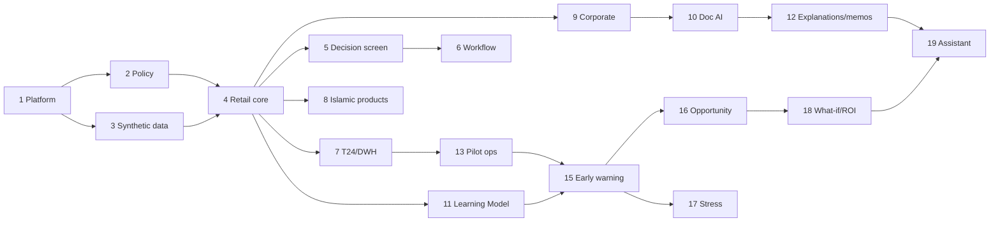

# AI Risk Score Card: Build Plan (overview)

Short overview of how the product will be built. The detail lives in the BMAD artifacts; run the build with
`BMAD-BUILD-PROMPT.md`.

| Document | What it holds |
|---|---|
| `_bmad-output/planning-artifacts/product-brief.md` | Why, who, differentiation, vision |
| `_bmad-output/planning-artifacts/prd.md` | 66 functional + 12 non-functional requirements, Glossary, release mapping |
| `_bmad-output/planning-artifacts/architecture.md` | Paradigm, 16 binding decisions (AD-1..16), stack, structure |
| `_bmad-output/planning-artifacts/epics.md` | 20 epics, 128 stories with acceptance criteria (parser-checked) |
| `_bmad-output/planning-artifacts/discovery-answers.md` | All 104 product-owner decisions |
| `docs/regulatory/cbuae-rules.md` | CBUAE rules with sources and confidence |

## Releases

| Release | Goal | Epics | Stories |
|---|---|---|---|
| **R1 Demo MVP** | Score a retail Islamic applicant end-to-end on "Demo Islamic Bank"; decision screen with drill-down; risk ranking of the book | 1–5 | 41 |
| **R2 Pilot-ready** | Corporate & SME, approval workflow + AD/SSO, T24 + data-warehouse connectors, Learning Model with governance, LLM explanations/memos (EN+AR), document AI, packaging, licence, onboarding packs | 6–14 | 63 |
| **R3 Full v1** | Nightly early warning & lifestyle mismatch, opportunity finder, offers & pricing, concentrations & stress tests, what-if & KPI/ROI, Portfolio Assistant, agentic annual review | 15–20 | 24 |

## Epics, squads and dependencies

| # | Epic | Rel. | Squad | Depends on |
|---|---|---|---|---|
| 1 | Platform Foundation & Demo Tenant Shell | R1 | Platform | — |
| 2 | Policy Engine & CBUAE Layer | R1 | Decision Core | 1 |
| 3 | Synthetic Data & Demo Data Source | R1 | Data & Integrations | 1 |
| 4 | Retail Assessment & Recommendation Core | R1 | Decision Core | 1, 2, 3 |
| 5 | Officer Decision Screen & Risk Ranking | R1 | Frontend | 1–4 |
| 6 | Enterprise Access & Approval Workflow | R2 | Platform + Frontend | 1, 2, 4, 5 |
| 7 | Bank Integration: T24 & Data Warehouse | R2 | Data & Integrations | 1–4 |
| 8 | Islamic Product Coverage & Retail Customer Types | R2 | Decision Core | 2, 4 |
| 9 | Corporate & SME Assessment | R2 | Decision Core | 2, 3, 4 |
| 10 | Document AI & Policy Extraction | R2 | AI/LLM | 2, 9 |
| 11 | Learning Model & Model Governance | R2 | ML & Analytics | 2, 3, 4 |
| 12 | AI Explanations & Credit Memos | R2 | AI/LLM | 4, 5, 10 |
| 13 | Pilot Operations: Nightly Run, Packaging, Licensing & Security | R2 | Platform | 1–4, 7 |
| 14 | Bank Onboarding & Commercial Readiness Pack | R2 | Delivery & Compliance | 1–13 |
| 15 | Early Warning & Behavioural Risk Signals | R3 | ML & Analytics | 4, 7, 11, 13 |
| 16 | Opportunity Finder, Pre-approved Offers & Pricing | R3 | ML & Analytics + Frontend | 4, 11, 13, 15 |
| 17 | Portfolio Concentrations & Stress Tests | R3 | ML & Analytics | 4, 9, 13, 15 |
| 18 | What-if Simulator & KPI/ROI Dashboard | R3 | Decision Core + Frontend | 2, 4, 13, 16 |
| 19 | Portfolio Assistant | R3 | AI/LLM | 12, 15–18 |
| 20 | Agentic Annual Review & Advanced Integrations | R3 | AI/LLM + Data & Integrations | 6, 7, 9, 10, 11, 12 |

## Indicative timeline (assumption, not a commitment)

Team: 6+ developers, 2-week sprints. **Assumed throughput: ~10–12 stories per sprint** once the foundation is in place.
Recalibrate after sprint 2 using the actual velocity in `sprint-status.yaml`.

| Release | Sprints (indicative) | Notes |
|---|---|---|
| R1 | 4 | Epic 1 is mostly sequential. Epics 2 and 3 run in parallel, then 4, then 5 |
| R2 | 6 | Squads run epics 6–13 in parallel. Epic 14 (documents) runs alongside from sprint 3 of R2 |
| R3 | 3 | Mostly ML & Analytics plus AI/LLM |
| **Total** | **≈ 13 sprints (≈ 26 weeks)** | Plus the pilot parallel run after R2 |

## Gates and checkpoints
- **Phase 1** (before coding): validate PRD and architecture (pin versions) and run the readiness check. The product owner signs off.
- **Each release**: the release gate in `BMAD-BUILD-PROMPT.md` §6 Phase 5, then a demo to the product owner. Update the banker PDF if needed.
- **Pilot** (after R2): parallel run at the Islamic bank, measured against PRD success metrics SM-1..SM-8.

## Still needed from the client
The bank's Credit Policy (manual + parameter sheet), deviation/authority matrix, corporate thresholds, score scale/PD bands, LGD/funding
cost/profit-rate grids, employer and restricted lists, Tier 1 capital, T24 version and integration method, pilot GPU size, and an anonymised
data sample if possible.
