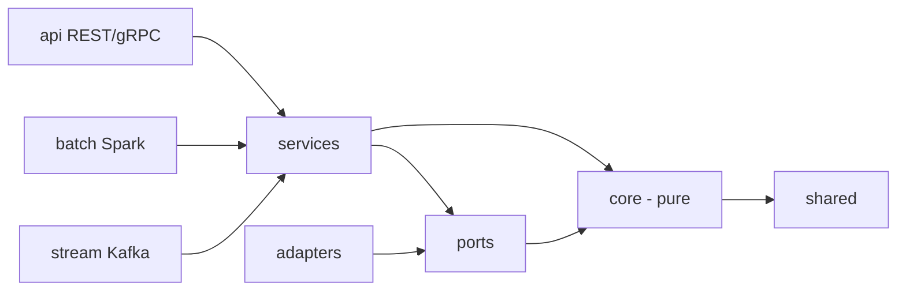

# Architecture Spine: AI Risk Score Card Global

## Design Paradigm
**Hexagonal services around a pure decision core**, with a **single feature definition** executed in two runtimes (online scoring and
Spark batch). The **market pack** (US or UK) and the bank policy are signed, effective-dated data. One codebase is deployed as
**separate installs per market** (US install, UK install). Within an install, entities (bank, card issuer, ring-fenced bank,
affiliates) are partitions.

| Layer | Package | May depend on |
|---|---|---|
| Decision core (pure) | `core/{packs,policy,features,affordability,scoring,reasons,limits,decision,frontier,scenarios,fairness}` | `shared` |
| Services (use-cases) | `services/*` (score, assess, simulate, validate, notices, workflow, copilot, collections, designer) | core, ports |
| Ports | `ports/*` (DecisionSource, BookSource, EventStream, Bureau, OpenBanking, IncomeVerify, AltData, MacroData, ClimateData, LLM, DocExtract, IdP, Vault, ConsentPlatform, NoticeSink, FraudSink, ModelRegistry, FeatureStore) | core types |
| Adapters | `adapters/*` | ports |
| Interfaces | `api/` (REST, gRPC for low-latency), `batch/` (Spark jobs), `stream/` (Kafka consumers), `ui/` | services |



## Invariants & Rules

### AD-1: Pure, deterministic decision core
- **Binds:** FR-7, FR-18–21, FR-29–32, NFR-5
- **Rule:** `assess(snapshot, pack_version, policy_version, model_versions, params) -> Assessment` is pure. No I/O, clock, network or LLM inside `core`. Every decision record stores everything needed to replay it exactly.

### AD-2: Market packs are signed, effective-dated data
- **Binds:** FR-2, FR-3, FR-20–23, FR-55–59
- **Rule:**
  - US and UK packs are versioned bundles (rules, dated tables such as QM thresholds, notice templates, reason-code libraries), each value with source and confidence.
  - Rules resolve by `effective_date`. Tighten-only is checked on bank policy publish.
  - A new country = a new pack; no core change.

### AD-3: One install per market; entities as partitions
- **Binds:** FR-1, NFR-3
- **Rule:** US and UK never share a deployment, database, model registry or support access. Inside an install, every row carries `entity_id`, and services enforce entity scoping. There is no cross-install API.

### AD-4: Single feature definition, two runtimes
- **Binds:** FR-8, FR-10, FR-11, FR-17, NFR-1, NFR-2
- **Rule:**
  - Features are pure Python functions over the **Canonical Data Model**, registered once.
  - Online: computed in-process or read from the online store (Redis via Feast).
  - Batch: the same functions run in Spark (pandas UDFs).
  - A parity test (online vs batch on the same sample) must pass in CI before release.

### AD-5: Two-limb assessment is structural
- **Binds:** FR-19, FR-20, FR-21
- **Rule:**
  - `Assessment` always has separate `credit_risk` and `affordability` (UK) / `ability_to_pay` (US) sections.
  - A failed affordability or ability-to-pay result can never be overridden by a score. Only a human deviation can override it, and only where the pack allows.

### AD-6: Reasons are deterministic; LLM is advisory
- **Binds:** FR-31, FR-55, FR-63–68
- **Rule:**
  - Reason codes come from rules and model attribution through the versioned reason library (≤ 4 for US notices). The LLM only paraphrases facts JSON.
  - Guardrail: every number and reason must exist in the facts, otherwise the template is used.
  - LLM calls are async and never in the decision path.
  - The LLM is behind `ports/LLM`: the bank's platform or vLLM on GPU. US/EU-origin model as the US default.

### AD-7: Mode-agnostic core
- **Binds:** FR-5, FR-6, FR-70
- **Rule:**
  - Challenger, add-on and engine modes call the same `assess`.
  - The mode only changes what is returned and persisted (shadow-only, score-only, or full decision + workflow).
  - Automation rules are policy data evaluated after `assess`. Declines are never automated (hard-coded invariant).

### AD-8: Model registry, approval and fallback
- **Binds:** FR-29, FR-33, FR-52, FR-53
- **Rule:**
  - MLflow registry holds all candidates.
  - A model may serve only with status `bank_mrm_approved` (set via maker-checker).
  - Drift triggers a challenger retrain, never auto-activation.
  - A breach sets `suspended`, and serving falls back to the configured fallback (bank champion score or our scorecard).
  - Bank champion models (PMML/ONNX/pickle) load in an isolated sandbox for validation only.

### AD-9: Protected data in a segregated fairness zone
- **Binds:** FR-15, FR-23, FR-50, FR-51
- **Rule:**
  - Protected attributes and proxies (BISG, UK monitoring data) live in a separate schema and service with its own roles.
  - Feature pipelines and models cannot read it; this is enforced by DB grants and a CI import-linter rule.
  - Fairness jobs join on tokens inside the zone and emit aggregates only.

### AD-10: Tokenisation at the ingestion boundary
- **Binds:** FR-15, FR-14
- **Rule:**
  - Adapters tokenise direct identifiers (keys held in the bank HSM/vault) and encrypt sensitive fields.
  - Only the reveal service, behind RBAC and audit, detokenises.
  - Consent state is checked at feature build. Revoked sources are excluded and recomputation is triggered.

### AD-11: Append-only, hash-chained records
- **Binds:** FR-7, FR-55, NFR-5
- **Rule:** Decision records, notice-content records, overrides and audit events are insert-only and hash-chained. Retention follows the per-market policy.

### AD-12: Latency budget for real-time
- **Binds:** FR-8, NFR-1
- **Rule:**
  - Real-time path budget: 300 ms p95 = 40 ms feature fetch + 60 ms rules/affordability + 60 ms model inference (ONNX/LightGBM native, EBM) + 40 ms reasons + margin.
  - No synchronous external calls except configured bureau/Open Banking adapters with timeouts and cached results; LLM excluded.
  - Stateless pods with horizontal autoscaling.

### AD-13: Generic change requests (maker-checker)
- **Binds:** FR-4, FR-33, FR-43, FR-66, FR-67
- **Rule:** One `ChangeRequest` entity covers policy, automation rules, model activation, pack update, product design and copilot/chat proposals. Checker ≠ maker is enforced in the service and in the DB.

### AD-14: Egress deny-by-default, air-gap capable
- **Binds:** NFR-3, FR-16, FR-75
- **Rule:** All outbound connections are off unless allow-listed per install (bureau, Open Banking, optional data feeds, update channel). Every asset is bundled. Updates are signed (Ed25519) and verified offline.

### AD-15: Scenario & climate as overlays, not features of record
- **Binds:** FR-30, FR-46–49
- **Rule:**
  - PIT PD = TTC PD × scenario/macro overlay (calibrated factor models by segment/sector/region) plus hazard overlays for collateral.
  - Overlays never change the TTC score used for decisions unless the bank policy explicitly references PIT.

### AD-16: Conventional vocabulary and market terms
- **Binds:** all
- **Rule:**
  - Identifiers follow the PRD Glossary: `loan`, `apr`, `affordability`, `ability_to_pay`, `reason_code`, `assessment`.
  - Market-specific terms live in pack text, not code.

## Consistency Conventions
| Concern | Convention |
|---|---|
| IDs | UUIDv7; `customer_token` pseudonymous; `entity_id` on every row |
| Money | integer minor units + ISO currency (USD/GBP); rates as Decimal |
| Dates | UTC storage; `effective_date` on packs/policies; local display |
| API | REST/JSON `/api/v1` (OpenAPI) + gRPC `ScoreService` for engines; error envelope `{error:{code,message,details,trace_id}}` |
| Events | Kafka topics `install.entity.domain.event`, Avro schemas in registry |
| Rules ids | `PACK.US.REGB.001`, `PACK.UK.CONC.5_2A.010`, `BANK.CARD.014`, `CRED.MORT.003` |
| Reasons | `RC.<family>.<code>` mapped to notice text per market/language |
| Logging | structured JSON, no PII, `trace_id` |
| Testing | pytest (unit/property), regulatory suites per rule id, fairness suite per model build, online/batch parity, Playwright E2E, k6 load, chaos (pod kill, adapter timeouts), LLM red-team |

## Stack (seed: verify and pin at build start)
| Area | Choice |
|---|---|
| Core & services | Python 3.12, FastAPI + gRPC (grpcio), Pydantic 2 |
| Models | LightGBM (constrained), InterpretML EBM, scikit-learn logistic; ONNX Runtime for serving; SHAP/TreeSHAP for attribution |
| Feature store | Feast (online Redis, offline Parquet/Delta) |
| Batch | Apache Spark 3.5 (bank Databricks or Spark-on-Kubernetes) |
| Streaming | Apache Kafka (bank cluster) + Python consumers (confluent-kafka) |
| Orchestration | Apache Airflow 2.x |
| Model registry | MLflow |
| App DB | PostgreSQL 16 (app, workflow, audit); object storage S3-compatible (MinIO) |
| LLM serving | Bank LLM platform via adapter, or vLLM on GPU (US default: US/EU-origin open model) |
| Document AI | pdfplumber + OCR (Tesseract) + LLM mapping with human confirmation |
| Frontend | React 18 + TypeScript + Vite; charting (ECharts/Recharts); WCAG 2.2 AA |
| Auth | OIDC/SAML to Entra ID/Okta/Ping; RBAC + attribute rules |
| Secrets/keys | HashiCorp Vault / bank HSM (PKCS#11) |
| Deploy | Kubernetes/OpenShift (Helm), Docker Compose for demos; air-gap bundles |
| CI | GitHub Actions; SBOM (CycloneDX), SAST/DAST, dependency audit |

## Structural Seed
```mermaid
flowchart TB
  subgraph Bank (one install per market)
    ENG[Bank decision engine / LOS] -- REST/gRPC --> API
    DWH[(Bank data platform)] --> SPARK
    KAFKA[(Bank Kafka)] --> STREAM
    IDP[SSO IdP] --> UI
    HSM[(HSM / Vault)] --- ADP
    subgraph AI Risk Score Card Global
      UI[React UI] --> API[Scoring & services API]
      API --> FS[(Feast online - Redis)]
      SPARK[Spark batch: features, nightly 50M+, PIT] --> FS
      STREAM[Kafka consumers: early warning] --> FS
      API --> PG[(PostgreSQL: decisions, workflow, audit)]
      SPARK --> PG
      AIR[Airflow] --> SPARK
      API --> REG[(MLflow registry)]
      API -.async.-> LLM[LLM port: bank LLM / vLLM]
      FZ[(Fairness zone - segregated)] --> FAIR[Fairness jobs]
      ADP[Adapters: bureaus, Open Banking, income, alt data, macro, climate]
    end
  end
```

```text
ai-risk-score-card-global/
  core/        packs/ policy/ features/ affordability/ scoring/ reasons/ limits/ decision/ frontier/ scenarios/ fairness/
  services/    score/ assess/ simulate/ validate/ notices/ workflow/ copilot/ collections/ designer/ offers/ inclusion/
  ports/  adapters/  api/  batch/  stream/  ui/
  packs/us/  packs/uk/            # signed regulator packs (rules, dated tables, notice templates, reason libraries)
  synth/                          # Demo US Bank (2M) + Demo UK Bank (1M) generators, champion scorecard, stress events
  deploy/helm/  deploy/compose/  deploy/airgap/
  docs/ (methodology, packs, governance packs, user/admin guides)
  tests/ (unit, property, regulatory/<rule-id>, fairness, parity, e2e, load, chaos, llm-redteam)
```

## Capability → Architecture Map
| Capability | Lives in | Governed by |
|---|---|---|
| Packs, policy, modes, automation (FR-1–7) | core/packs, core/policy, services/assess | AD-2, AD-3, AD-7, AD-13 |
| Integration & data (FR-8–17) | api, batch, stream, adapters | AD-4, AD-10, AD-12, AD-14 |
| Consumer & commercial assessment (FR-18–28) | core/affordability, core/limits, core/decision | AD-1, AD-5 |
| Models & scoring (FR-29–34) | core/scoring, services/validate, MLflow | AD-8, AD-1 |
| Inclusion & Gen Z (FR-35–40) | services/inclusion, services/offers | AD-9, AD-10 |
| Frontier, designer, offers (FR-41–45) | core/frontier, services/designer, services/offers | AD-1, AD-13 |
| Macro, climate, early warning (FR-46–49) | core/scenarios, stream, batch | AD-15, AD-4 |
| Fairness, validation, packs (FR-50–54) | core/fairness, services/validate | AD-9, AD-8 |
| Notices, safeguards, UK servicing (FR-55–59) | services/notices, services/workflow, core/decision | AD-6, AD-11 |
| Collections (FR-60–62) | services/collections | AD-6, AD-13 |
| LLM (FR-63–68) | adapters/llm, services/copilot | AD-6, AD-13 |
| UX (FR-69–74) | ui, synth | AD-16 |
| Deployment, licence, ops (FR-75–78) | deploy, services/licence | AD-14, AD-11 |

## Deferred
- gRPC vs REST default per bank engine: decided with the pilot bank.
- Exact macro overlay model form (per segment): methodology doc during R3.
- Oracle/SQL Server as app DB: PostgreSQL only in v1.
- UI localisation beyond English: outputs only (Spanish/Welsh letters).
- Additional markets (EU, Canada, Australia): new packs later.
