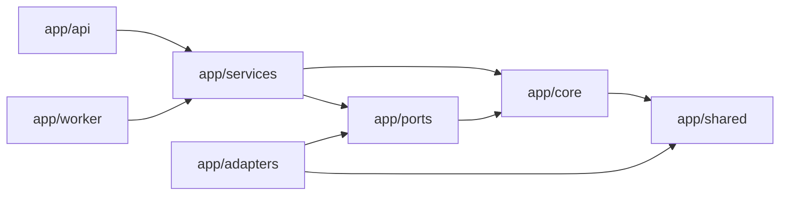
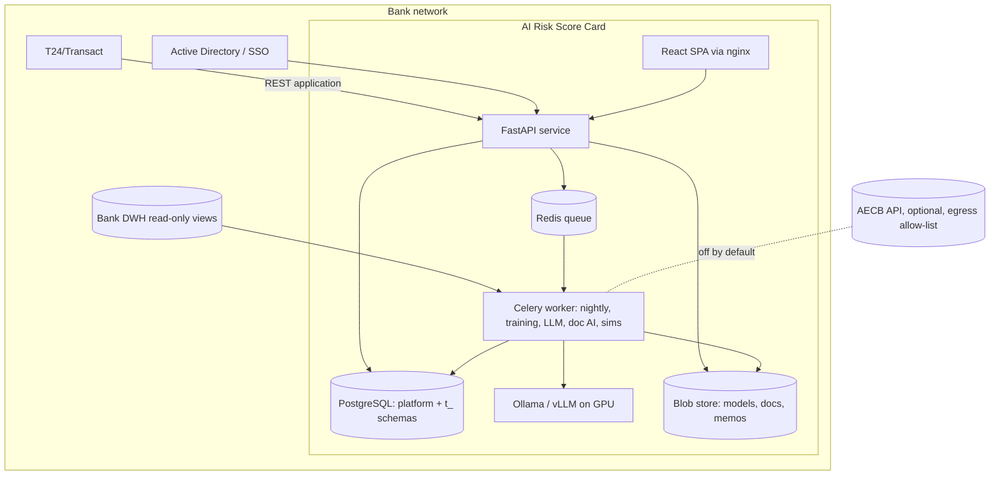
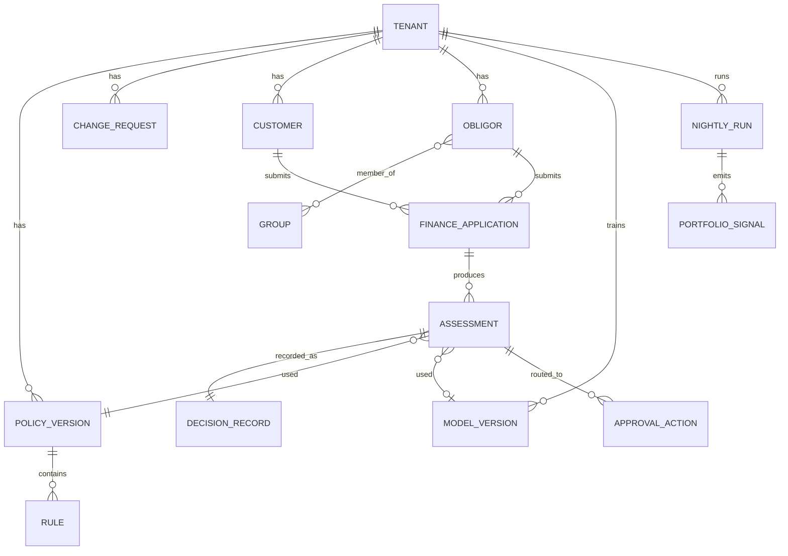

# Architecture Spine: AI Risk Score Card

## Design Paradigm

**Hexagonal modular monolith.** A pure **decision core** (domain) is surrounded by **ports** (interfaces) and **adapters**
(T24, SQL warehouse, demo DB, LLM, AD/SSO, storage). There is one deployable API service, one async worker service and one web SPA,
plus infrastructure (database, queue, LLM runtime). Platform modules added later (collections, credit administration, …) become new
bounded-context packages that follow the same rules.

| Layer | Package (backend `app/`) | May depend on |
|---|---|---|
| Domain core (pure) | `app/core/{policy,features,scoring,decision,limits,portfolio}` | `app/shared` only |
| Application services | `app/services/*` (use-cases, orchestration, maker-checker) | core, ports |
| Ports (interfaces) | `app/ports/*` | core types |
| Adapters | `app/adapters/{t24,sqlsource,demo,llm,auth,storage,aecb,docai}` | ports, shared |
| Interfaces | `app/api` (FastAPI), `app/worker` (jobs) | services |
| Shared kernel | `app/shared` (ids, money, dates, errors, i18n keys) | nothing |



## Invariants & Rules

### AD-1: Pure, deterministic decision core [ADOPTED]
- **Binds:** FR-19–35, FR-61, NFR-6
- **Prevents:** non-reproducible decisions; replay drift.
- **Rule:** `assess(snapshot, policy_version, model_version, params) -> Assessment` is a pure function. Inside `app/core` there is no I/O, no network, no wall-clock, no randomness without a fixed seed, and **no LLM**. Everything a decision needs is passed in as a frozen snapshot.

### AD-2: Tenant isolation = one database schema per Tenant
- **Binds:** FR-1, FR-17, NFR-3, NFR-4
- **Prevents:** cross-bank data leakage in multi-bank installs.
- **Rule:** Each Tenant has its own schema (`t_<tenant_code>`) plus a shared `platform` schema (tenants, licences, users-to-tenant mapping only). The DB session is bound to one tenant schema per request or job via middleware. Cross-tenant queries are forbidden in code review and by a test that scans for schema-qualified SQL.

### AD-3: Policy as data, evaluated by a safe DSL
- **Binds:** FR-2–10, FR-20, FR-25, FR-33, FR-34
- **Prevents:** rules hard-coded in Python; unsafe `eval`; looser-than-regulator configs.
- **Rule:**
  - Rules are JSON/YAML documents (schema `policy-rule.schema.json`) with `id, layer, applies_to, condition, severity, source, confidence, direction?`.
  - Conditions are evaluated by `app/core/policy/expr.py`, an allow-listed AST evaluator. Only comparisons, arithmetic, boolean logic, `in` and whitelisted functions are permitted.
  - Policy Versions are immutable. The **tighten-only check** runs on publish and blocks any looser value.
  - The **regulator pack** (`regulatory/cbuae/…`) is a separate, signed, versioned artifact. Adding QCB/SAMA = a new pack, no code change (NFR-9).

### AD-4: One feature pipeline for real-time and batch
- **Binds:** FR-11, FR-15, FR-19, FR-24, FR-44
- **Prevents:** training/serving skew; a Nightly Run that disagrees with real-time.
- **Rule:**
  - All features are computed by `app/core/features` from the **Canonical Data Model (CDM)** (`app/shared/cdm.py`, Pydantic).
  - Adapters map source data → CDM. Features never read source schemas.
  - Training, real-time and nightly all call the same feature functions.

### AD-5: Ports for every external system; read-only data sources
- **Binds:** FR-11–16, FR-28, FR-39
- **Prevents:** vendor lock-in leaking into the core; accidental writes to bank systems.
- **Rule:**
  - Ports: `ApplicationSource`, `BookSource`, `BureauSource`, `LLMClient`, `DocExtractor`, `IdentityProvider`, `BlobStore`, `Notifier`.
  - Source adapters must use read-only credentials and expose no write methods.
  - The demo adapter implements the same ports over a bundled synthetic DB (FR-14).

### AD-6: LLM is an advisory side-channel
- **Binds:** FR-5, FR-40–43, FR-56, FR-65
- **Prevents:** hallucinated numbers in credit files; the LLM influencing decisions.
- **Rule:**
  - The LLM receives only a **facts JSON** produced after the decision.
  - The output passes the **guardrail**: every number and Rule id must exist in the facts, otherwise the template fallback is used.
  - LLM calls run in the worker, asynchronously, with timeouts.
  - Draft Rules, memos and reviews are stored as drafts with status, never auto-published.

### AD-7: Generic Change Request (maker-checker) mechanism
- **Binds:** FR-6, FR-34, FR-54, FR-56, FR-57, FR-58
- **Prevents:** each feature inventing its own approval logic; self-approval.
- **Rule:**
  - Every controlled change goes through one `ChangeRequest` entity (types: `policy`, `model_activation`, `deviation_matrix`, `assistant_action`, `regulator_pack`).
  - It records maker, checker, payload diff and status. Checker ≠ maker is enforced in the service layer **and** by a DB constraint.

### AD-8: Model registry & serving fallback
- **Binds:** FR-30–32, FR-57–60
- **Prevents:** unapproved models in production; outages when the model fails.
- **Rule:**
  - Model artifacts are stored in `BlobStore` with a SHA-256, a model card and the training data snapshot hash.
  - Only one `active` model per Tenant and segment, set via ChangeRequest.
  - Serving resolves the active version per request. Auto-suspension flips it to `suspended`, and the Scorecard-only path is used automatically.
  - Training runs only in the worker.

### AD-9: Append-only, hash-chained audit and Decision Records
- **Binds:** FR-61, FR-62, NFR-5
- **Prevents:** silent edits to history; unreplayable decisions.
- **Rule:**
  - `decision_record` and `audit_event` are insert-only. Each row stores `prev_hash` and `row_hash`, and DB permissions deny UPDATE/DELETE to the app role.
  - Replay = load the snapshot, policy version and model version, call `assess`, and compare hashes.

### AD-10: PII boundary at ingestion
- **Binds:** FR-17, NFR-4
- **Prevents:** PII spreading across tables, logs and LLM prompts.
- **Rule:**
  - Adapters pseudonymise direct identifiers into `pii_vault` (encrypted columns, key from the secret store) and pass only `customer_key` onwards.
  - Logs and LLM prompts never contain clear PII. Reveal goes through one audited service.

### AD-11: Deny-by-default egress
- **Binds:** NFR-3, FR-16, FR-63
- **Prevents:** data exfiltration; hidden telemetry.
- **Rule:**
  - All outbound connections are disabled unless listed in `egress.allowlist` (AECB API, update server), each switched on by an admin ChangeRequest.
  - Front-end and back-end bundle all assets. No CDNs at runtime.

### AD-12: Glossary-exact Islamic vocabulary in code and API
- **Binds:** all
- **Prevents:** "loan/interest" drift between squads; UI and API inconsistency.
- **Rule:**
  - Identifiers use PRD Glossary terms: `finance_amount`, `profit_rate`, `finance_application`, `obligor`, `risk_grade`, `recommendation`, `deviation`.
  - "loan" and "interest" are banned in identifiers and UI strings (lint rule).

### AD-13: Database portability through the ORM
- **Binds:** FR-13, H5
- **Prevents:** Postgres-only SQL blocking SQL Server/Oracle installs.
- **Rule:**
  - Application data uses SQLAlchemy 2 Core/ORM + Alembic migrations, with PostgreSQL as the default.
  - No vendor-specific SQL outside `app/adapters/sqlsource` dialect modules.
  - CI runs the migration and repository test suite on PostgreSQL and SQL Server (Oracle in R3).

### AD-14: API contract
- **Binds:** FR-11, all UI features
- **Prevents:** inconsistent endpoints and error shapes between squads.
- **Rule:**
  - REST/JSON under `/api/v1`, OpenAPI generated by FastAPI and committed. The front-end client is generated from it.
  - Error envelope: `{"error":{"code":"…","message":"…","details":{…},"trace_id":"…"}}`.
  - Every endpoint declares its required permission.

### AD-15: Async work through a queue
- **Binds:** FR-5, FR-28, FR-40–42, FR-44, FR-53–58, FR-65
- **Prevents:** long jobs blocking the real-time API.
- **Rule:**
  - The real-time API does only the synchronous `assess` (NFR-1).
  - LLM, document AI, Nightly Run, training, simulations and stress tests run as worker jobs (Celery + Redis), with job state in the DB and idempotent tasks keyed by `(tenant, job_type, input_hash)`.

### AD-16: Signed releases, offline licence
- **Binds:** FR-63, FR-64
- **Prevents:** tampered updates; licence bypass by network tricks.
- **Rule:**
  - Release bundles (images, regulator packs, migrations) are signed (Ed25519) and verified before applying.
  - Licence = signed JSON (bank id, tenants, modules, expiry), verified offline at start-up and daily.
  - Expired licence → read-only mode.

## Consistency Conventions

| Concern | Convention |
| --- | --- |
| Naming | Python `snake_case`; TS `camelCase`; DB `snake_case` plural tables; Rule ids `LAYER.SEGMENT.NNN` (e.g. `CBUAE.RET.001`, `BANK.RET.014`, `CRED.CORP.003`); events `domain.entity.verb` |
| IDs | UUIDv7 for entities. `customer_key` is a pseudonymous UUID. External ids are kept as `source_ref` |
| Money | Integer minor units (fils) + ISO currency (`AED`). Never floats for money. Rates in basis points or `Decimal` |
| Dates | UTC ISO-8601 in storage/API; Asia/Dubai shown in the UI; `as_of_date` on every snapshot |
| Errors | AD-14 envelope. Domain errors are typed (`PolicyViolation`, `DataIncomplete`, …) and mapped in the API layer |
| Config | Per-tenant config in the DB (versioned); infra config via env vars; secrets via vault/OS keystore. No secrets in the repo |
| Logging | Structured JSON, `trace_id`, `tenant`, never PII (AD-10) |
| Auth | OIDC/SAML (AD) in R2, local accounts in R1 demo; RBAC permission strings `resource:action` |
| i18n | UI strings in `en` (structure ready for `ar`). Explanations/memos as `{en, ar}` pairs; Arabic documents rendered RTL |
| Testing | pytest (unit/property tests for maths and DSL); contract tests on ports; Playwright E2E; k6 performance; Bandit + ZAP + dependency audit in CI |
| Determinism | Seeds fixed in config; library versions locked (`uv.lock`, `package-lock.json`) |

## Stack

Seed. **Verify the latest stable patch at build start and pin it in lockfiles.**

| Name | Version line |
| --- | --- |
| Python | 3.12 |
| FastAPI / Pydantic | FastAPI current stable / Pydantic 2.x |
| SQLAlchemy / Alembic | 2.x / current |
| PostgreSQL (default DB) | 16+ |
| SQL Server / Oracle (supported) | 2019+ / 19c+ |
| Redis + Celery | Redis 7 / Celery 5 |
| LightGBM / scikit-learn / pandas | 4.x / 1.x / 2.x |
| LLM runtime | Ollama (default) or vLLM. Models: Qwen (14B-class instruct) or Llama (8B-class), chosen by GPU size |
| PDF extraction | pdfplumber + Tesseract OCR (scanned) + LLM table mapping |
| Document rendering | WeasyPrint (PDF memos with Arabic RTL) + openpyxl (Excel exports) |
| Auth libs | Authlib (OIDC) / python3-saml / ldap3 |
| Front-end | React 18+, TypeScript 5, Vite, TanStack Query, a component library with RTL support (e.g. Ant Design) |
| Packaging | Docker Compose; Windows Server installer (R2) |
| Tooling | uv (Python deps), ruff, mypy, pytest, Playwright, k6, Bandit, OWASP ZAP; GitHub Actions CI |

## Structural Seed





```text
ai-risk-score-card/
  backend/
    app/
      shared/        # cdm.py, money, ids, errors, i18n keys
      core/          # PURE: policy/ (expr, engine, tighten), features/ (retail, corporate, eosb, dbr, behaviour),
                     #       scoring/ (scorecard, pd_map, grades, blend), decision/, limits/, portfolio/ (signals, stress, concentration)
      ports/         # interfaces
      adapters/      # t24/, sqlsource/, demo/, llm/, docai/, auth/, storage/, aecb/
      services/      # assess, workflow, change_requests, policy_import, models, nightly, simulator, assistant, audit, licence
      api/           # FastAPI routers (v1), deps, permissions
      worker/        # celery app + tasks
    regulatory/cbuae/        # signed regulator pack (rules + sources + confidence)
    tenants/demo_islamic_bank/   # demo policy versions, deviation & authority matrices, employer list
    synth/                   # synthetic T24-like data generator + golden sets
    migrations/              # alembic
    tests/                   # unit, property, contract, integration
  frontend/                  # React + TS SPA (src/features/<feature>/…)
  deploy/                    # docker-compose, nginx, windows-installer/, release signing
  docs/                      # methodology, data dictionary, packs (security, PDPL, CBUAE outsourcing, Sharia), user & admin guides
  e2e/  perf/                # Playwright, k6
```

## Capability → Architecture Map

| Capability (PRD) | Lives in | Governed by |
| --- | --- | --- |
| Tenancy (FR-1) | services/tenancy, DB schemas | AD-2 |
| Policy layers, import, maker-checker (FR-2–10) | core/policy, services/policy_import, services/change_requests | AD-3, AD-7 |
| Data integration (FR-11–18) | adapters/t24, sqlsource, demo, aecb; services/ingest | AD-4, AD-5, AD-10, AD-11 |
| Retail & corporate assessment (FR-19–29) | core/features, core/policy, adapters/docai | AD-1, AD-4, AD-12 |
| Scoring & grades (FR-30–32) | core/scoring, services/models | AD-1, AD-8 |
| Recommendation, deviations, limits (FR-33–36) | core/decision, core/limits | AD-1, AD-3 |
| Workflow & access (FR-37–39) | services/workflow, adapters/auth, api | AD-7, AD-14 |
| Explanations, memos, guardrail (FR-40–43) | adapters/llm, services/explain, worker | AD-6, AD-15 |
| Portfolio intelligence (FR-44–53) | core/portfolio, services/nightly, worker | AD-1, AD-4, AD-15 |
| Simulator & KPI/ROI (FR-54–55) | services/simulator, core/portfolio | AD-1, AD-7 |
| Portfolio Assistant (FR-56) | services/assistant, adapters/llm | AD-6, AD-7 |
| Model lifecycle (FR-57–60) | services/models, worker | AD-8, AD-7 |
| Audit & replay (FR-61–62) | services/audit | AD-1, AD-9 |
| Deployment, licence (FR-63–64) | deploy/, services/licence | AD-11, AD-16 |
| Agentic annual review (FR-65) | services/annual_review, worker | AD-6, AD-15 |
| Demo Tenant (FR-66) | synth/, tenants/demo_islamic_bank, adapters/demo | AD-5 |

## Deferred

- **Message-queue integration with T24 (vs. REST):** decide with the pilot bank's integration team (PRD open question 1).
- **Exact GPU sizing and LLM model choice per bank:** chosen at install from detected hardware; benchmark harness in R2.
- **Oracle CI matrix:** R3. PostgreSQL and SQL Server cover R1/R2.
- **Kubernetes / HA clustering:** not needed for < 100k-customer pilot; revisit for large banks.
- **Arabic UI (RTL screens):** structure ready (i18n keys); translation out of v1 scope (outputs are bilingual).
- **Future platform modules** (collections, credit administration, model risk, op-risk/fraud): new bounded contexts under `app/core/<module>` following AD-1–AD-16.
