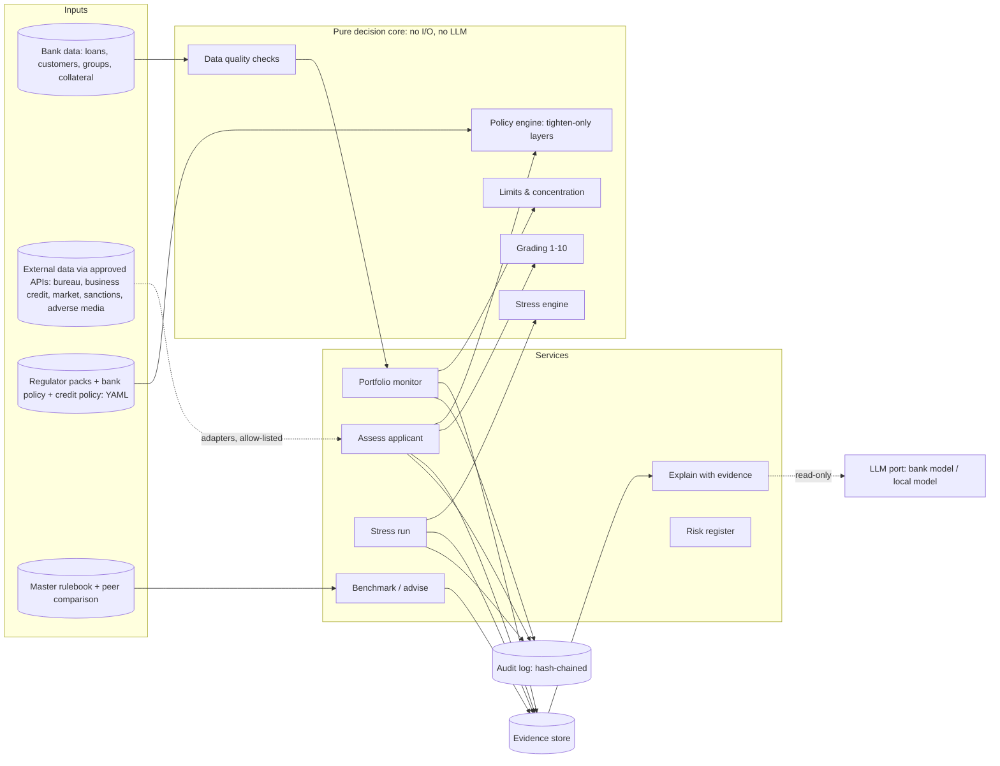

# AI Risk Platform: Blueprint v1 (the skeleton)

> **Bones now, organs later.** This blueprint fixes the *shape* of the whole platform: every part, how the parts connect, and the rules they obey. Each part has a working minimal version, so the skeleton runs end to end on a fictional bank. The detail (real models, real bank data, full rulebooks, UI polish) is added later without changing the shape.

## 1. The problem we solve (one paragraph)
Banks make credit decisions on scattered, hard-to-verify information. Staff cannot quickly get citable answers to risk and compliance questions, and credit assessment is slow and inconsistent across individuals, businesses and corporates. The platform runs **inside each bank**. It:
- grades every borrower **1–10**;
- applies **central bank → bank policy → credit policy** rules, where **policy always wins** over the AI;
- watches the **whole loan book** for limit breaches and problems;
- runs **stress tests**;
- shows each bank where it is **too rigid or taking too much risk** against its regulator and peers (Faisal's comparison);
- answers questions **with evidence**.

## 2. Six capabilities (the skeleton's limbs)

| # | Capability | Question it answers | Skeleton module | Status v1 |
|---|---|---|---|---|
| A | **Decide** | Should we lend to this applicant, and why? | `core/policy`, `core/grading`, `services/assess` | Working (rules + illustrative scorecard) |
| B | **Monitor** | Where are our exposures and which limits are breached? | `services/portfolio`, `core/limits`, `core/quality` | Working (groups, sectors, countries, entities, staging) |
| C | **Stress** | What happens if things get worse (e.g. bad loans go 1% → 2%)? | `core/stress`, `services/stress` | Working (credit, FX, combined; illustrative) |
| D | **Benchmark** | Is this bank too rigid or too risky vs regulator and peers? | `services/benchmark` + `master-rulebook/` | Working (retail); SME/corporate after research |
| E | **Explain** | Why did this happen? Show me the evidence. | `services/explain`, `ports/llm` | Working (evidence-linked templates); LLM later |
| F | **Govern** | Who changed what, what is not covered, what is overdue? | `audit/`, `services/register`, maker-checker | Audit + risk register working; maker-checker stub |

**Segments:** retail, SME, corporate and finance houses.
**Markets (packs):** UAE (Islamic and conventional), UK, US.

## 3. Shape of the system



**Layers:** the same as the Global spine:
- `core` is pure;
- `services` orchestrate;
- `ports` / `adapters` handle the outside world;
- `packs` hold the regulator rules as data.

The skeleton keeps exactly this folder shape, so later work fills in rather than restructures.

## 4. Rules the skeleton obeys
**Inherited from the Global architecture:**
- **AD-1:** the pure core.
- **AD-2:** packs are effective-dated data.
- **AD-6:** the LLM is advisory and reasons are deterministic.
- **AD-7:** declines are never fully automated (grades 9–10 give *Decline recommended*, which a human confirms).
- **AD-11:** hash-chained audit.
- **AD-13:** maker-checker.
- **AD-14:** egress is denied by default.

**New in v1:**

| ID | Rule |
|---|---|
| **AD-17 Data labels** | Every dataset and every number carries a label: `real`, `de-identified`, `synthetic` or `assumed`. Reports show it. A model trained on synthetic defaults is never presented as predictive. |
| **AD-18 Answer-sheet acceptance** | The demo bank contains planted problems with a hidden answer sheet. The build passes only if every planted problem is detected with the expected amount. |
| **AD-19 Evidence or silence** | Every figure the Explain service states links to an evidence record (rule ID, record IDs, calculation). If there is no evidence, it says "not available" and does not guess. Retrieved documents are data, never instructions. |
| **AD-20 Portfolio engines are read-only** | Monitor and Stress never change positions, limits or decisions. They emit findings with owners. |
| **AD-21 Coverage honesty** | Risks not yet calculated (market, liquidity, operational, third-party, model, conduct, financial crime, cyber, strategic, reputational, climate) live in the risk register with status `not implemented`. They never get an unexplained score. |
| **AD-22 Reproducible run** | One config file (`config/run.yaml`) fixes the data version, reporting date, FX, limits and scenarios. The same config gives the same result hash. |

## 5. Data model (canonical, minimal)

| Entity | Key fields (v1) | Label in demo |
|---|---|---|
| `legal_entity` | entity_id, country, currency, equity (capital) | synthetic |
| `customer` | customer_id, entity_id, segment (retail/sme/corporate), group_id, sector, country | synthetic |
| `facility` (loan) | facility_id, customer_id, product, currency, balance, limit, rate, origination, maturity, collateral_value, dpd, stage, approved_by, approval_authority | synthetic |
| `application` | application_id, customer_id, product, amount, term, income, debts, bureau_score, bureau_date, financials (revenue, ebitda, debt, dscr) | synthetic |
| `fx_rate` | currency, rate_to_reporting, as_of | assumed (illustrative) |
| `rule` | id, layer, applies_to, condition, severity, direction, limit, source, confidence | real (from rulebooks) or assumed |
| `limit` | limit_id, scope (group/sector/country/entity), threshold, basis | assumed (illustrative) |
| `scenario` | scenario_id, shocks, order of events | assumed |
| `finding` | finding_id, type, severity, amount, evidence_ids, owner, status | output |
| `evidence` | evidence_id, kind (rule/record/calc), refs, values | output |
| `audit_event` | seq, ts, actor, action, payload_hash, prev_hash | output |
| `risk_register_item` | risk_id, category, owner, controls, proposed_metrics, status | assumed |

**Real data, when available, enters through adapters only:**
- bank loan books;
- the Freddie Mac / Fannie Mae loan-level datasets, for a *real* US mortgage default model;
- market and FX feeds.

## 6. The demonstration (one-page spec)
- **Fictional bank:** "Demo Group" with three entities (UAE, UK, US) and retail, SME and corporate loans. Sizes are set in config; the skeleton default is about 2,000 facilities and 200 new applications.
- **Script:**
  1. Baseline book.
  2. A limit breach found, a hidden borrower group.
  3. Credit stress, where bad loans double.
  4. Results change.
  5. Trace a number to its records and rules.
  6. Ask "why?" and get an evidence-linked answer.
  7. Assign the action to an owner.
  8. Show the audit trail.
- **Planted problems (answer sheet):**

| ID | Problem | Detected by |
|---|---|---|
| P1 | Three differently named borrowers belong to one group that exceeds the single-borrower limit | Monitor (group aggregation) |
| P2 | Retail application with DBR above the regulator's 50% (UAE) | Decide (regulator layer) |
| P3 | Duplicate facility rows in the source file | Data quality |
| P4 | Loan approved above the approver's authority | Monitor (governance check) |
| P5 | Real-estate concentration above the illustrative sector cap (UAE entity) | Monitor (sector limit) |
| P6 | UK mortgage application above the bank's loan-to-income maximum | Decide (bank layer) |
| P7 | Credit-bureau report older than 90 days at decision | Decide (credit layer) |
| P8 | Corporate loan 95 days past due still in Stage 1 | Monitor (staging check) |
| P9 | Bank policy rule looser than the regulator (fails tighten-only) | Policy publish check |

**What the demo proves, and what it doesn't (honest by design):**

| What | Status |
|---|---|
| Ingestion, rules, calculations, alerts, evidence, audit | **Technically proven** |
| Grade accuracy | **Not proven.** The scorecard is illustrative. Predictive claims need real outcomes, e.g. Freddie Mac for US mortgages, or pilot-bank data. |
| Production reliability, regulatory acceptance, real integration, unimplemented risks | **Unproven** |

## 7. From skeleton to organs (roadmap)

| Phase | Adds | Depends on |
|---|---|---|
| **0 Skeleton (now)** | All six capabilities, minimal; demo bank; answer-sheet tests | Done in `risk-platform/` |
| **1 Muscles** | Full regulator packs from the master rulebooks (retail, finance houses, SME, corporate); Excel/PDF benchmark wired in | Current research run |
| **2 Organs** | Real models: US mortgage PD on Freddie Mac data; SME/corporate rating models (expert scorecards, then data); macro overlays | Data access approval; expert input |
| **3 Nerves** | LLM explanation through the port (local or bank model), document retrieval over rulebooks; red-team tests | Model choice; evaluation set |
| **4 Skin** | Streamlit demo UI, then React; role-based access; maker-checker workflow | Phase 1–3 |
| **5 Blood supply** | Bank integration (LOS, data warehouse), external APIs (bureau, sanctions, adverse media), monitoring | Pilot bank |

## 8. Where each piece lives (code skeleton)
```text
risk-platform/
  config/run.yaml            # reporting date, currency, FX, limits, scenarios, sizes, labels
  packs/{uae,uk,us}/regulator.yaml   # regulator layer (from master rulebooks)
  packs/demo_group/{bank_policy,credit_policy}.yaml
  riskplatform/
    core/      policy.py  grading.py  limits.py  stress.py  quality.py  (pure)
    services/  assess.py  portfolio.py  stress.py  benchmark.py  explain.py  register.py
    ports/     llm.py     (interface; NullLLM default)
    adapters/  csv_store.py
    audit/     log.py     (hash-chained JSONL)
  synth/generate.py          # demo bank + planted problems + answer sheet
  run_demo.py                # end-to-end run -> outputs/
  tests/test_answer_sheet.py
  app/streamlit_app.py       # optional UI shell
```
